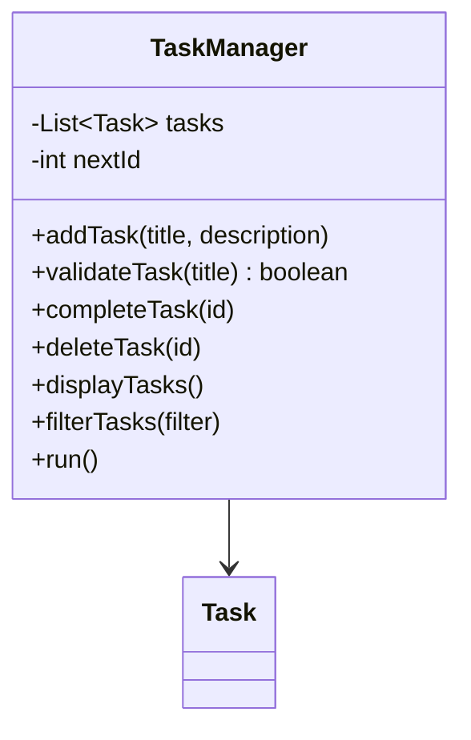
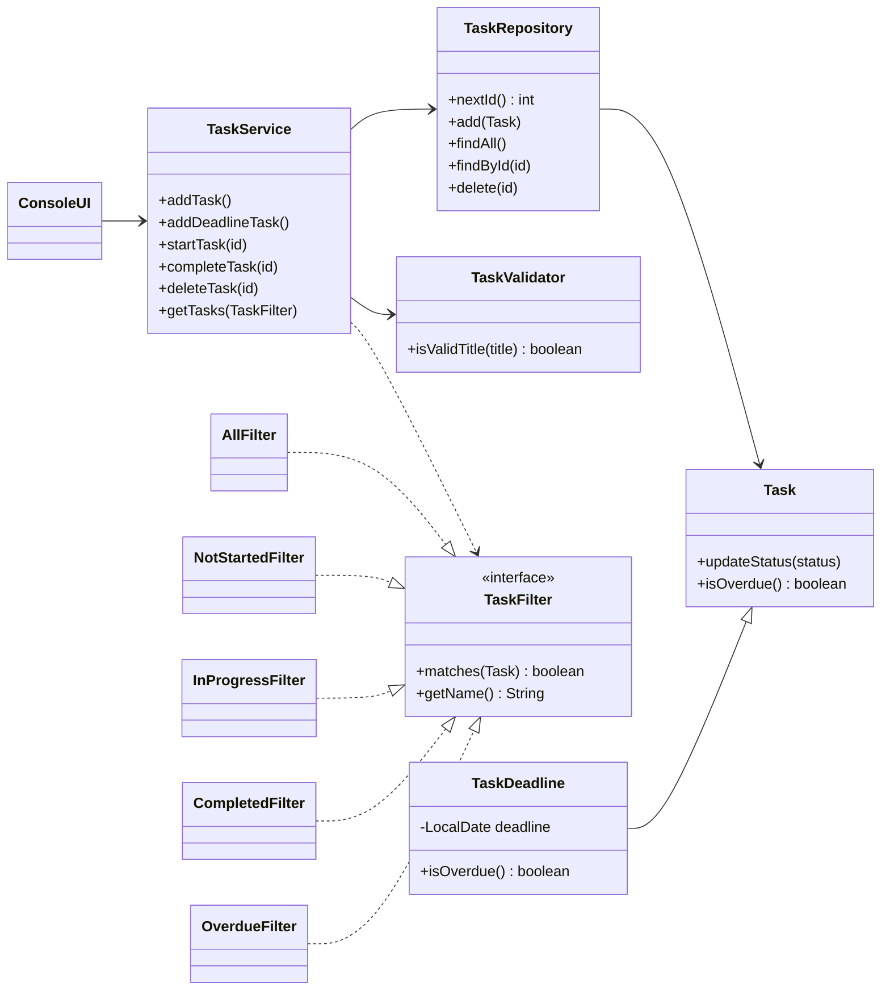
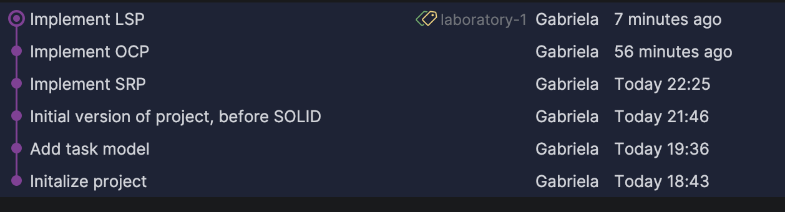
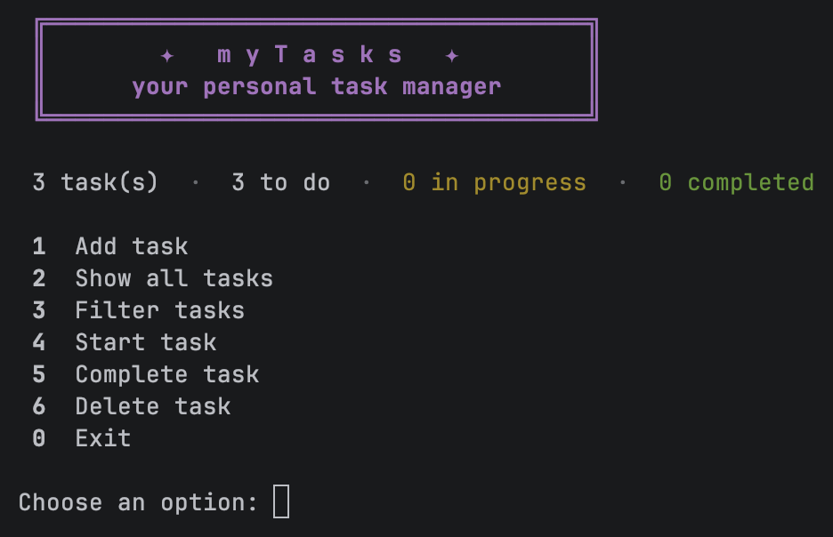
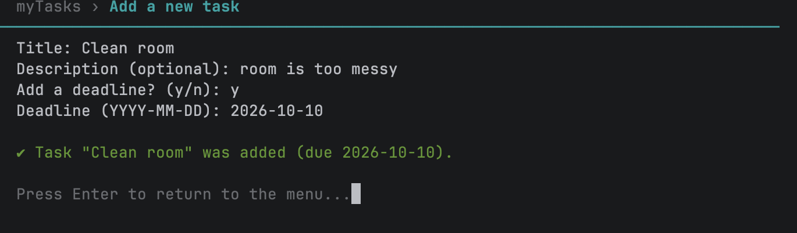
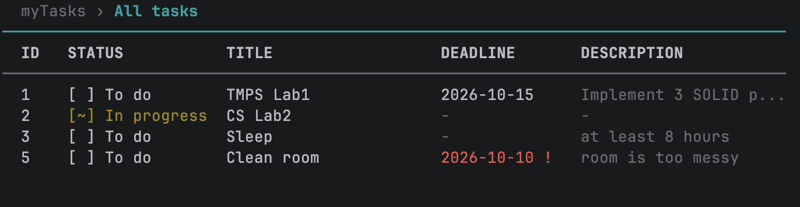
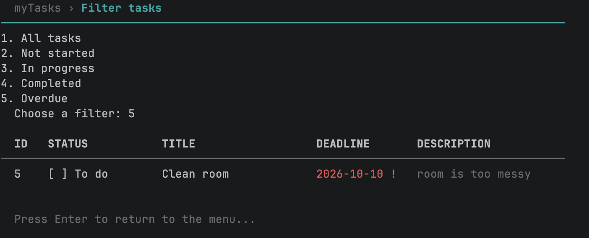
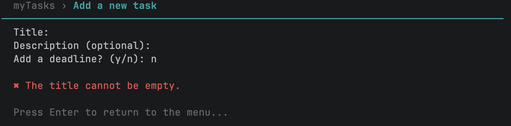

# Lab 1 - SOLID Principles

**Project:** myTasks - a personal task manager (console application)\
**Author:** Gabriela Bîtca, FAF-242\
**Language:** Java 21 **Build tool:** Maven

---

## Objectives

- Get familiar with the SOLID principles.
- Build a small project that will be extended in all the following labs.
- Apply 3 SOLID principles in that project: **SRP**, **OCP** and **LSP**.

## Domain

**myTasks** is a console task manager. The user can:

- add a task with a title and a description, optionally with a **deadline**;
- see all tasks in a table (ID, status, title, deadline, description);
- **start** a task (`NOT_STARTED → IN_PROGRESS`) and **complete** it (`→ COMPLETED`);
- delete a task;
- filter tasks: all, not started, in progress, completed or **overdue**.

A task with a deadline is *overdue* when its date has passed and it is not completed yet. Overdue deadlines are shown in red with a `!`.

## Chosen SOLID principles

| Principle | Where it is applied |
|---|---|
| **S** - Single Responsibility | `TaskRepository`, `TaskValidator`, `TaskService`, `ConsoleUI` and `Main` each have one job |
| **O** - Open/Closed | The `TaskFilter` interface: a new filter is a new class (`OverdueFilter` was added without changing any existing code) |
| **L** - Liskov Substitution | `TaskDeadline extends Task` and can be used anywhere a `Task` is expected: in the repository, the service, every filter and the UI |

---

## Starting point: the version that breaks SOLID

I started with a working version where one class, `TaskManager`, did everything (commit `9fa421b` — *Initial version of project, before SOLID*). A shortened version:

```java
public class TaskManager {
    private List<Task> tasks = new ArrayList<>();       // storage
    private int nextId = 1;

    public void addTask(String title, String description){
        if (validateTask(title)) {                      // validation
            Task task = new Task(nextId, title, description);
            tasks.add(task);
            nextId++;
            System.out.println("Task added succesfully :3");   // output
        }
    }

    public boolean validateTask(String title){
        if (title == null || title.trim().isEmpty()) {
            System.out.println("Error: Task title cannot be empty!");
            return false;
        }
        return true;
    }

    public void filterTasks(String filter){             // filtering
        for (Task task : tasks){
            if (filter.equalsIgnoreCase("in_progress") && task.getTaskStatus() == TaskStatus.IN_PROGRESS){
                System.out.println(task);
            }
            else if (filter.equalsIgnoreCase("completed") && task.getTaskStatus() == TaskStatus.COMPLETED){
                System.out.println(task);
            }
            else if (filter.equalsIgnoreCase("not_started") && task.getTaskStatus() == TaskStatus.NOT_STARTED){
                System.out.println(task);
            }
        }
    }

    public void run(){ /* the whole console menu with a Scanner */ }   // user interface
}
```

Problems with this version:

- **It breaks SRP.** The class stores tasks, generates ids, validates input, filters, prints and runs the menu. A change in any of these (e.g. a new validation rule or a different menu) means editing the same class.
- **It breaks OCP.** Every new filter means adding another `else if` inside `filterTasks()`, so existing, working code has to be modified.
- There is only one kind of task, so LSP does not apply yet.

---

## Implementation

### Project structure

```
lab1/src/main/java/com/mytasks/
├── Main.java                    creates the objects and connects them
├── model/
│   ├── Task.java                a task: id, title, description, status
│   ├── TaskDeadline.java        a task with a deadline (subclass of Task)
│   └── TaskStatus.java          NOT_STARTED, IN_PROGRESS, COMPLETED
├── repository/
│   └── TaskRepository.java      stores tasks and gives out ids
├── validation/
│   └── TaskValidator.java       checks the input for a new task
├── service/
│   └── TaskService.java         the use cases: add, start, complete, delete, filter
├── filter/
│   ├── TaskFilter.java          the filter interface
│   ├── AllFilter.java
│   ├── NotStartedFilter.java
│   ├── InProgressFilter.java
│   ├── CompletedFilter.java
│   └── OverdueFilter.java
└── ui/
    └── ConsoleUI.java           menu, input and output
```

### 1. Single Responsibility Principle (SRP)

> A class should have only one reason to change.

I split `TaskManager` into classes that each have one job:

| Class | Its only responsibility | It changes when… |
|---|---|---|
| `Task`, `TaskDeadline` | Hold the data of a task | a task gets new fields |
| `TaskRepository` | Store tasks and give out ids | the way tasks are stored changes |
| `TaskValidator` | Decide if the input is valid | the validation rules change |
| `TaskService` | Run the use cases | the rules of the application change |
| `ConsoleUI` | Talk to the user (menu, input, output) | the look of the console changes |
| `Main` | Create the objects and connect them | the set-up changes |

The most important check: **only `ConsoleUI` reads input or prints**. `TaskService`, `TaskRepository` and `TaskValidator` contain no `System.out` and no `Scanner`, so the same logic could be used with a different interface.

For example, validation now lives in one small class:

`validation/TaskValidator.java`
```java
public class TaskValidator {
    public boolean isValidTitle(String title) {
        return title != null && !title.trim().isEmpty();
    }
}
```

And the service only coordinates: it asks the validator, creates the task and gives it to the repository. It does not print anything; it returns `true`/`false` and the UI decides what message to show.

`service/TaskService.java`
```java
public TaskService(TaskRepository repository, TaskValidator validator) {
    this.repository = repository;
    this.validator = validator;
}

public boolean addTask(String title, String description) {
    if (!validator.isValidTitle(title)) {
        return false;
    }
    repository.add(new Task(repository.nextId(), title, description));
    return true;
}
```

`Main` is the only place where the objects are created and connected:

`Main.java`
```java
TaskRepository repository = new TaskRepository();
TaskValidator validator = new TaskValidator();
TaskService service = new TaskService(repository, validator);
ConsoleUI ui = new ConsoleUI(service);
ui.run();
```

### 2. Open/Closed Principle (OCP)

> Software entities should be open for extension, but closed for modification.

The `if / else if` chain was replaced by an interface. Each filter is its own class:

`filter/TaskFilter.java`
```java
public interface TaskFilter {
    boolean matches(Task task);
    String getName();
}
```

`filter/CompletedFilter.java`
```java
public class CompletedFilter implements TaskFilter {
    @Override
    public boolean matches(Task task) {
        return task.getTaskStatus() == TaskStatus.COMPLETED;
    }

    @Override
    public String getName() {
        return "Completed";
    }
}
```

The service works with **any** filter and does not know which one it receives:

`service/TaskService.java`
```java
public List<Task> getTasks(TaskFilter filter) {
    return repository.findAll()
            .stream()
            .filter(filter::matches)
            .collect(Collectors.toList());
}
```

**The proof:** after the first four filters were done, I added the "Overdue" filter. I only created a **new class** and added one line to the filter menu. `TaskService`, `TaskFilter` and the other filters were not modified.

`filter/OverdueFilter.java`
```java
public class OverdueFilter implements TaskFilter {
    @Override
    public boolean matches(Task task) {
        return task.isOverdue();
    }

    @Override
    public String getName() {
        return "Overdue";
    }
}
```

The repository follows the same idea: it has a single `add(Task task)` method, so a new kind of task does not require a new method in the repository.

### 3. Liskov Substitution Principle (LSP)

> Objects of a subtype must be usable wherever the parent type is expected, without breaking the program.

I added a second kind of task, a task with a deadline, as a subclass of `Task`:

`model/TaskDeadline.java`
```java
public class TaskDeadline extends Task {
    private final LocalDate deadline;

    public TaskDeadline(int id, String title, String description, LocalDate deadline){
        super(id, title, description);
        this.deadline = deadline;
    }

    @Override
    public boolean isOverdue(){
        return getTaskStatus() != TaskStatus.COMPLETED && deadline.isBefore(LocalDate.now());
    }
}
```

The parent class defines what "overdue" means for a normal task. A task without a deadline can never be overdue:

`model/Task.java`
```java
public boolean isOverdue(){
    return false;
}
```

**Why this follows LSP:** a `TaskDeadline` can replace a `Task` everywhere, and the program still behaves correctly:

- the repository stores both in the same `List<Task>` through `add(Task task)`;
- `startTask()`, `completeTask()` and `deleteTask()` in the service work on any `Task`;
- every filter receives a `Task`. `OverdueFilter` simply calls `task.isOverdue()`, and each type answers correctly: a plain task says `false`, a deadline task checks its date. No `instanceof` is needed.

`TaskDeadline` only **adds** behaviour (a deadline). It keeps every promise of `Task`: it can be started and completed, it always has an id, a title and a status, and `isOverdue()` always returns a valid answer.

**What a violation would look like** (not in the project, only as an example). Imagine a `ReadOnlyTask` that cannot be completed:

```java
public class ReadOnlyTask extends Task {
    public ReadOnlyTask(int id, String title, String description) {
        super(id, title, description);
    }

    @Override
    public void updateStatus(TaskStatus status) {
        throw new UnsupportedOperationException("This task cannot be changed");
    }
}
```

`TaskService.completeTask()` expects that **every** `Task` can be completed. With a `ReadOnlyTask` in the list, choosing "Complete task" would crash the program. That subtype could not replace its parent, so it would break LSP.

---

## Refactoring (bonus)

**Before:** one class did everything.



**After:** each class has one job, filters are interchangeable and `TaskDeadline` extends `Task`.



**Commit history.** Each step of the refactoring is a separate commit:



---

## Results

Main menu:



Adding a task with a deadline:



All tasks (task 2 was started, task 4 is overdue):




Filter "Overdue" (works for every task type through `Task.isOverdue()`):




Validation (the message comes from the UI, from `TaskValidator`):



## How to run

- **IntelliJ IDEA:** open `lab1/src/main/java/com/mytasks/Main.java` and press ▶.
- **With screen clearing:** open `lab1/run.sh` and press ▶ next to the first line. It runs the app in IntelliJ's terminal, where the screen is cleared between menus.

## Conclusion

Starting from one class that did everything made the problems easy to see. After applying **SRP**, every class has one clear job, and the console is the only part that talks to the user. With **OCP**, a new filter is just a new class: the overdue filter was added without touching the existing code. With **LSP**, a task with a deadline can be used anywhere a normal task is expected, and the program keeps working without checking the type of the task. This structure will make it easier to add design patterns to the same project in the next labs.
