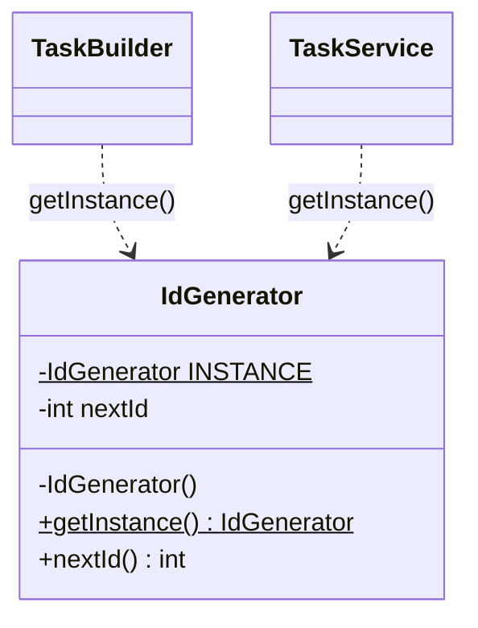
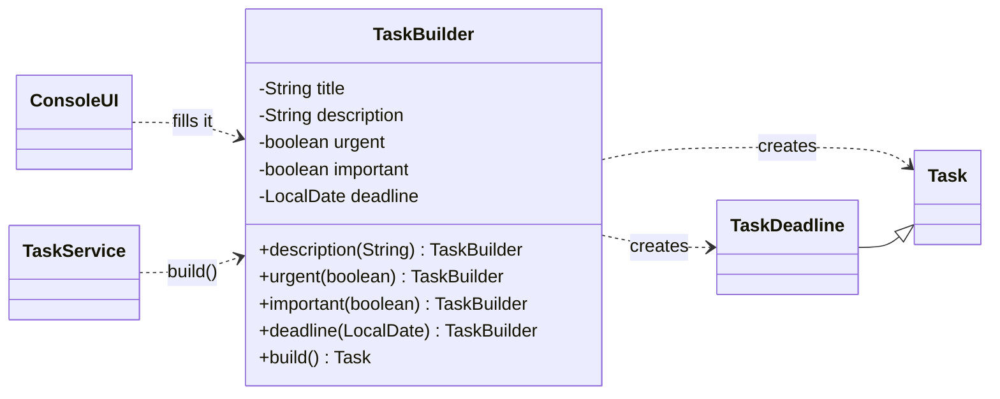
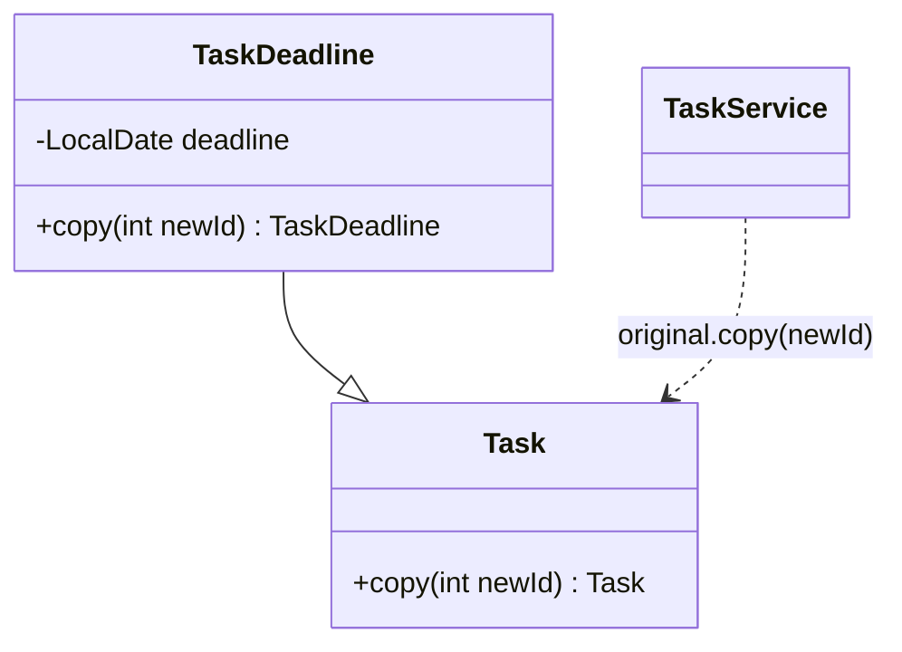
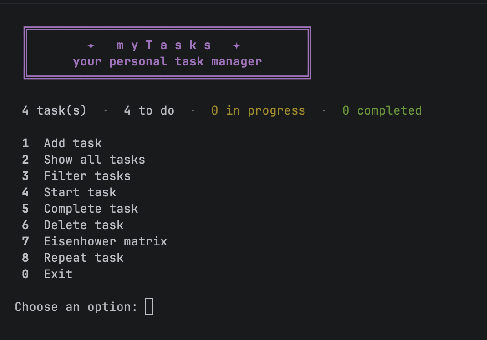
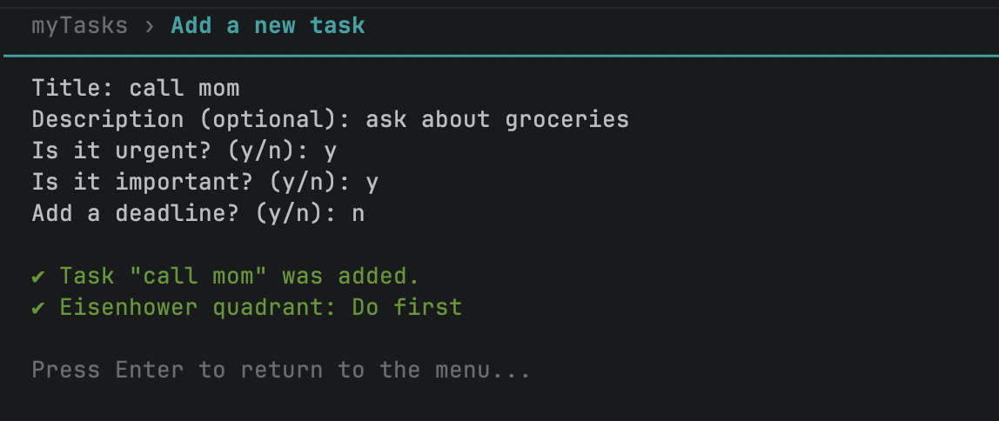
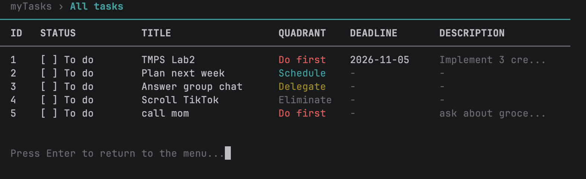
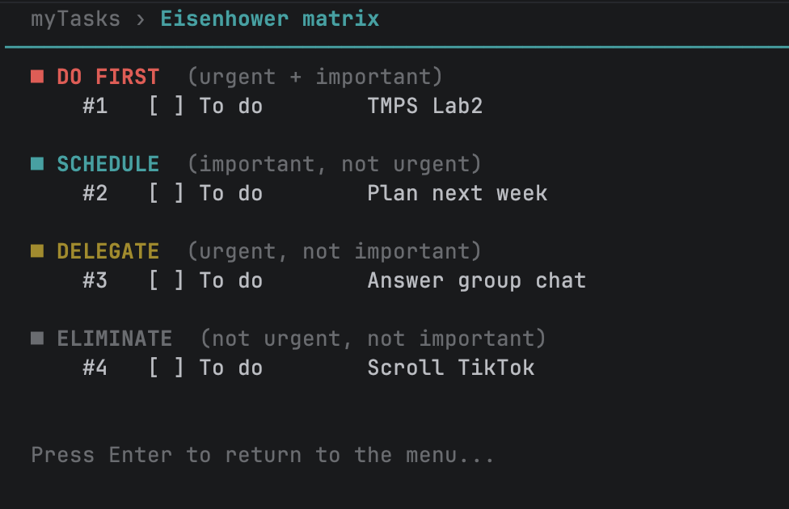
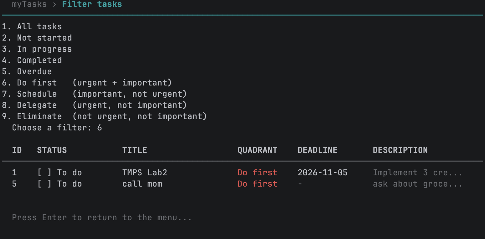
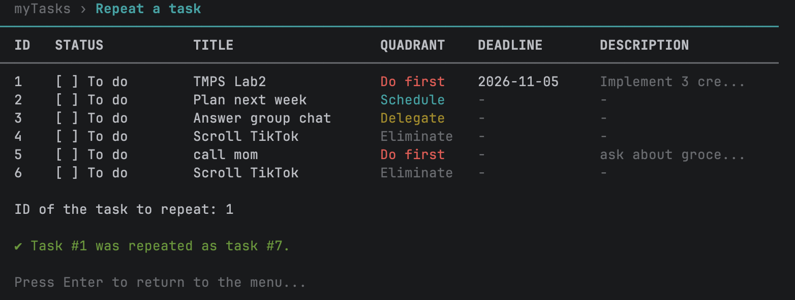

# Lab 2 - Creational Design Patterns

**Project:** myTasks - a personal task manager (console application)\
**Author:** Gabriela Bîtca, FAF-242\
**Language:** Java 21 **Build tool:** Maven

---

## Objectives

- Study the creational design patterns.
- Continue the myTasks project from Lab 1 with new functionality.
- Implement 3 creational patterns: **Singleton**, **Builder** and **Prototype**.

## New functionality: Eisenhower matrix

The Eisenhower matrix sorts tasks by two questions: **is it urgent?** and **is it important?** The two answers put every task into one of four boxes (quadrants):

| | Urgent | Not urgent |
|---|---|---|
| **Important** | **Do first** | **Schedule** |
| **Not important** | **Delegate** | **Eliminate** |

In this lab, myTasks was extended so that the user can:

- answer *"Is it urgent?"* and *"Is it important?"* when adding a task;
- see the quadrant of every task in a new **QUADRANT** column, in its own color;
- filter tasks by quadrant (e.g. only "Do first");
- open the **Eisenhower matrix** view, where all tasks are grouped into the four boxes;
- **repeat** a task (e.g. a weekly lab or the gym), which creates a fresh copy of it.

The quadrant is calculated from the two answers in one place, the `Quadrant` enum:

`model/Quadrant.java`
```java
public enum Quadrant {
    DO_FIRST("Do first", "urgent + important"),
    SCHEDULE("Schedule", "important, not urgent"),
    DELEGATE("Delegate", "urgent, not important"),
    ELIMINATE("Eliminate", "not urgent, not important");

    // ...label, meaning and their getters...

    public static Quadrant of(boolean urgent, boolean important) {
        if (urgent && important) {
            return DO_FIRST;
        }
        if (important) {
            return SCHEDULE;
        }
        if (urgent) {
            return DELEGATE;
        }
        return ELIMINATE;
    }
}
```

The quadrant filter is a new class implementing `TaskFilter`, so the **Open/Closed Principle** from Lab 1 still holds: no existing filter or the service had to be changed.

`filter/QuadrantFilter.java`
```java
public class QuadrantFilter implements TaskFilter {
    private final Quadrant quadrant;

    public QuadrantFilter(Quadrant quadrant) {
        this.quadrant = quadrant;
    }

    @Override
    public boolean matches(Task task) {
        return task.getQuadrant() == quadrant;
    }

    @Override
    public String getName() {
        return quadrant.getLabel();
    }
}
```

## Chosen patterns

| Pattern | Where it is applied | Why it is needed |
|---|---|---|
| **Singleton** | `IdGenerator` | Task ids must be unique in the whole application, so there must be exactly one id counter |
| **Builder** | `TaskBuilder` | A task has 1 required field and 4 optional ones; the constructors became long and unreadable |
| **Prototype** | `Task.copy()` / "Repeat task" | Recurring tasks are created by copying an existing task instead of typing it again |

---

## Implementation

### Project structure

```
lab2/src/main/java/com/mytasks/
├── Main.java                    creates the objects and the sample tasks
├── model/
│   ├── Task.java                a task: id, title, description, status, urgent, important
│   ├── TaskDeadline.java        a task with a deadline (subclass of Task)
│   ├── TaskBuilder.java         Builder: creates tasks step by step          (new)
│   ├── Quadrant.java            the 4 boxes of the Eisenhower matrix         (new)
│   └── TaskStatus.java          NOT_STARTED, IN_PROGRESS, COMPLETED
├── util/
│   └── IdGenerator.java         Singleton: the only id counter               (new)
├── repository/
│   └── TaskRepository.java      stores tasks
├── validation/
│   └── TaskValidator.java       checks the input for a new task
├── service/
│   └── TaskService.java         the use cases: add, start, complete, repeat, delete, filter
├── filter/
│   ├── TaskFilter.java          the filter interface
│   ├── AllFilter.java, NotStartedFilter.java, InProgressFilter.java,
│   ├── CompletedFilter.java, OverdueFilter.java
│   └── QuadrantFilter.java      tasks of one Eisenhower quadrant             (new)
└── ui/
    └── ConsoleUI.java           menu, input and output
```

### 1. Singleton

> **Singleton** ensures that a class has **only one instance** and gives a global access point to it.

It has three parts:

1. a `private` constructor, so no other class can write `new IdGenerator()`;
2. a `static` field that holds the only instance;
3. a `static getInstance()` method that returns it.

**The problem in myTasks.** In Lab 1, the id counter was inside `TaskRepository`. Now tasks are created in two places, by the Builder and by "Repeat task", and both need a new id. If each of them had its own counter, two tasks could get the same id, and "complete task #3" would not know which task is meant. There must be **exactly one** counter for the whole application.

`util/IdGenerator.java`
```java
// Singleton: the one and only id counter
public final class IdGenerator {

    private static final IdGenerator INSTANCE = new IdGenerator();

    private int nextId = 1;

    // no other class can write "new IdGenerator()"
    private IdGenerator() {
    }

    public static IdGenerator getInstance() {
        return INSTANCE;
    }

    public int nextId() {
        return nextId++;
    }
}
```

**How it is used.** Every place that needs an id asks the same instance:

```java
int id = IdGenerator.getInstance().nextId();
```

It is used in `TaskBuilder.build()` and in `TaskService.repeatTask()`. Because both use the same instance, the ids are always 1, 2, 3, … without duplicates.

 The counter was removed from `TaskRepository`, so the repository now has only one job: storing tasks (SRP from Lab 1).



### 2. Builder

> **Builder** separates the construction of a complex object from its representation: the object is created **step by step**, and only the parts that are needed are set.

**The problem in myTasks.** After adding the Eisenhower matrix, a task has one required field (the title) and four optional ones: description, urgent, important and deadline. Creating a task with the constructor looked like this:

```java
new TaskDeadline(id, "TMPS Lab2", "Implement 3 creational patterns", true, true, LocalDate.of(2026, 11, 5));
```

It is impossible to tell which `true` means *urgent* and which means *important*, and it is easy to swap them by mistake. The service also needed two methods, `addTask(...)` and `addDeadlineTask(...)`, one for each kind of task.

**The solution.** `TaskBuilder` has a method with a clear name for each part. Every method returns `this`, so the calls can be chained. `build()` creates the finished object and also decides **which class** to create: a `TaskDeadline` if a deadline was set, otherwise a plain `Task`.

`model/TaskBuilder.java`
```java
public class TaskBuilder {
    private final String title;           // required
    private String description = "";      // optional parts, with default values
    private boolean urgent = false;
    private boolean important = false;
    private LocalDate deadline = null;

    public TaskBuilder(String title) {
        this.title = title;
    }

    public TaskBuilder description(String description) {
        this.description = description;
        return this;                      // returning "this" allows chaining: .description(..).urgent(..)
    }

    public TaskBuilder urgent(boolean urgent) {
        this.urgent = urgent;
        return this;
    }

    public TaskBuilder important(boolean important) {
        this.important = important;
        return this;
    }

    public TaskBuilder deadline(LocalDate deadline) {
        this.deadline = deadline;
        return this;
    }

    public String getTitle() {
        return title;
    }

    // a TaskDeadline if a deadline was set, otherwise a plain Task
    public Task build() {
        int id = IdGenerator.getInstance().nextId();   // the id comes from the Singleton
        if (deadline == null) {
            return new Task(id, title, description, urgent, important);
        }
        return new TaskDeadline(id, title, description, urgent, important, deadline);
    }
}
```

**How it is used.** The same task as above, now readable:

`Main.java`
```java
service.addTask(new TaskBuilder("TMPS Lab2")
        .description("Implement 3 creational patterns")
        .urgent(true)
        .important(true)
        .deadline(LocalDate.of(2026, 11, 5)));
service.addTask(new TaskBuilder("Plan next week").important(true));
service.addTask(new TaskBuilder("Answer group chat").urgent(true));
service.addTask(new TaskBuilder("Scroll TikTok"));
```

Optional parts that are not needed are simply not called; they keep their default values.

In the console, the builder is filled **step by step, in the same order as the questions** the user answers:

`ui/ConsoleUI.java`
```java
TaskBuilder builder = new TaskBuilder(title)
        .description(description)
        .urgent(urgent)
        .important(important);

LocalDate deadline = null;
if (readYesNo("Add a deadline? (y/n): ")) {
    deadline = readDate("Deadline (YYYY-MM-DD): ");
    builder.deadline(deadline);
}

boolean added = service.addTask(builder);
```

The service now needs **one** method for every kind of task. It validates the title first and only then calls `build()`, so a rejected task does not use up an id:

`service/TaskService.java`
```java
public boolean addTask(TaskBuilder builder) {
    if (!validator.isValidTitle(builder.getTitle())) {
        return false;
    }

    repository.add(builder.build());
    return true;
}
```



### 3. Prototype

> **Prototype** creates new objects by **copying an existing object** (the prototype) instead of building them from scratch. Each class knows how to copy itself.

**The problem in myTasks.** Many tasks repeat: a lab every week, the gym, a weekly report. Typing the title, description, urgency, importance and deadline again every time is tedious. The new task is almost the same as an existing one; only a few things are different:

- the **id** (it is a new task);
- the **status** (it starts again as "To do");
- the **deadline** (it moves one week later).

**The solution.** `Task` has a `copy()` method that creates a copy of itself with a new id. The status is not copied, so the copy starts as `NOT_STARTED`:

`model/Task.java`
```java
public Task copy(int newId){
    return new Task(newId, title, description, urgent, important);
}
```

`TaskDeadline` overrides `copy()`. The copy of a deadline task is again a deadline task, due **one week later**:

`model/TaskDeadline.java`
```java
/** Prototype: repeating a deadline task creates the same task, due one week later. */
@Override
public TaskDeadline copy(int newId){
    return new TaskDeadline(newId, getTitle(), getDescription(), isUrgent(), isImportant(), deadline.plusWeeks(1));
}
```

**How it is used.** The service finds the original task and asks it to copy itself. It gets the new id from the Singleton:

`service/TaskService.java`
```java
// Prototype: repeats a task by copying an existing one.
public Task repeatTask(int id) {
    Task original = repository.findById(id);

    if (original == null) {
        return null;
    }

    Task copy = original.copy(IdGenerator.getInstance().nextId());
    repository.add(copy);
    return copy;
}
```

The important line is `original.copy(...)`: the service **does not know** whether `original` is a `Task` or a `TaskDeadline`. Each type copies itself correctly. A plain task gives a fresh "To do" copy, and a deadline task gives a copy due one week later. No `instanceof` is needed, so the **Liskov Substitution Principle** from Lab 1 still holds.

**Why not `clone()`?** Java has a built-in `Cloneable` interface with `clone()`, but it makes a shallow copy, throws a checked exception and cannot give the copy a new id or reset its status. A `copy()` method is clearer and does exactly what the application needs.



### How the three patterns work together

1. When the user adds a task, the console fills a **Builder** step by step.
2. `build()` asks the **Singleton** for a new id and creates a `Task` or a `TaskDeadline`.
3. When the user repeats a task, the existing task is used as a **Prototype**: it copies itself, and the copy also gets its id from the same **Singleton**.

---

## Results

Main menu with the new options (7 Eisenhower matrix, 8 Repeat task):



Adding a task: the urgent/important questions, then the quadrant it belongs to:



All tasks, with the new QUADRANT column:



The Eisenhower matrix view:



Filter by quadrant ("Do first"):



Repeating a task: the copy gets a new id, starts as "To do", and its deadline moves one week later:



## How to run

- **IntelliJ IDEA:** open `lab2/src/main/java/com/mytasks/Main.java` and press ▶.
- **With screen clearing:** open `lab2/run.sh` and press ▶ next to the first line. It runs the app in IntelliJ's terminal, where the screen is cleared between menus.

## Conclusion

The Eisenhower matrix made tasks richer, and that showed why creational patterns are useful. The **Builder** replaced long constructors full of `true`/`false` values with readable, named steps, and it let the service create every kind of task with one method. The **Singleton** guarantees one id counter for the whole application, so every task has a unique id no matter where it is created. The **Prototype** turned recurring tasks into a single action: an existing task copies itself, and each type knows how to do it correctly. The SOLID structure from Lab 1 made these changes easy: new filters and new creation code were added without rewriting the existing classes.
