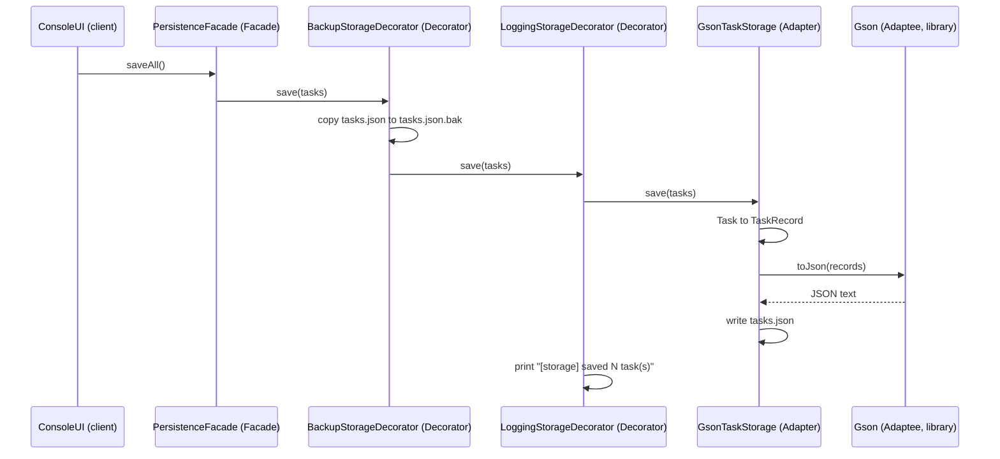
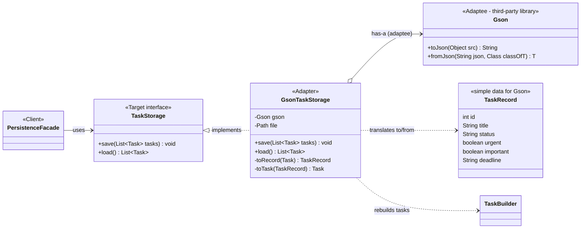
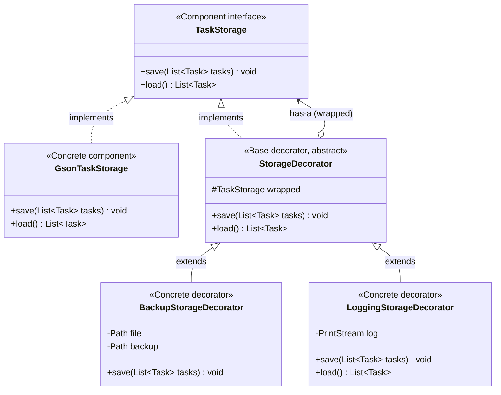
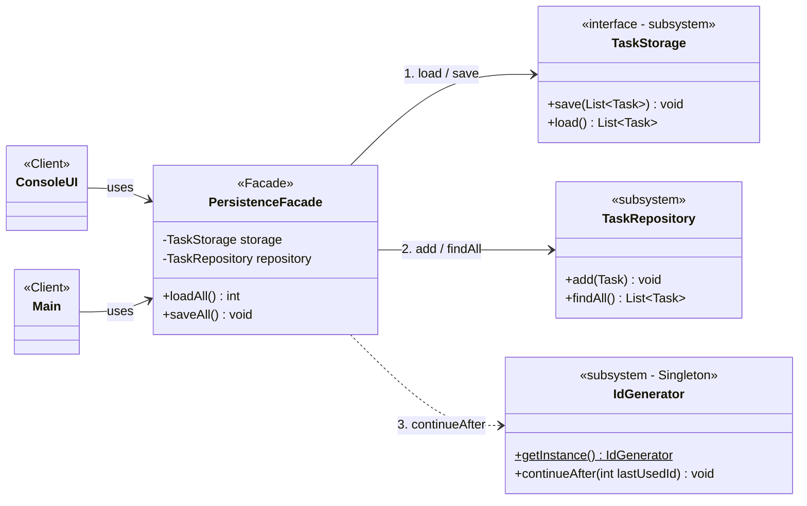
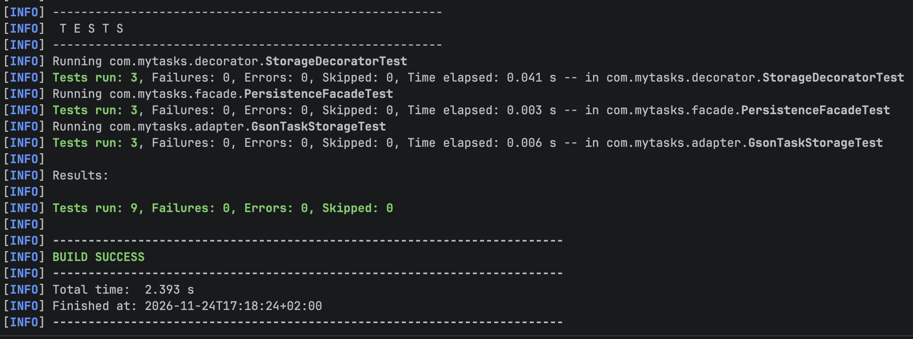
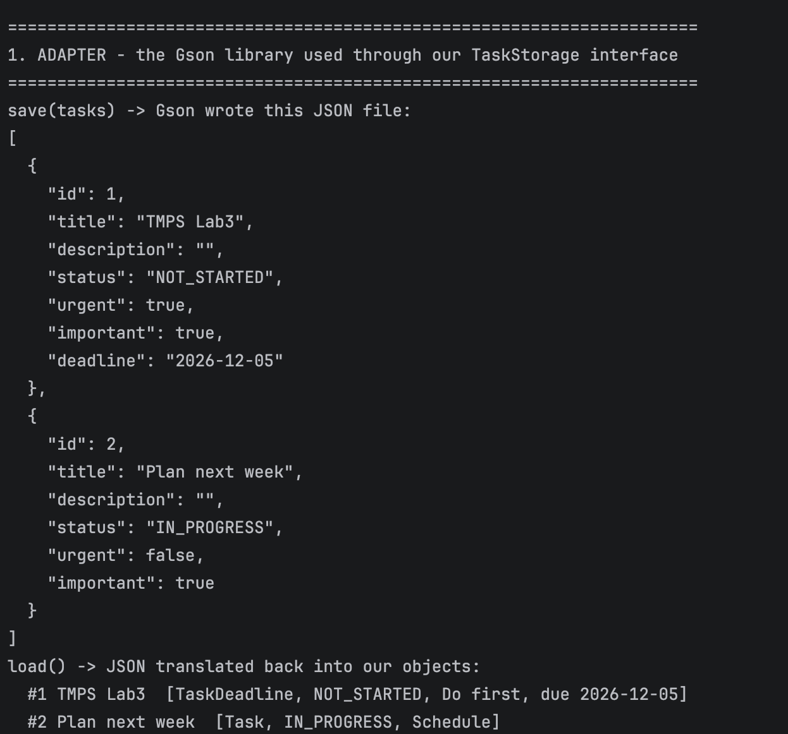
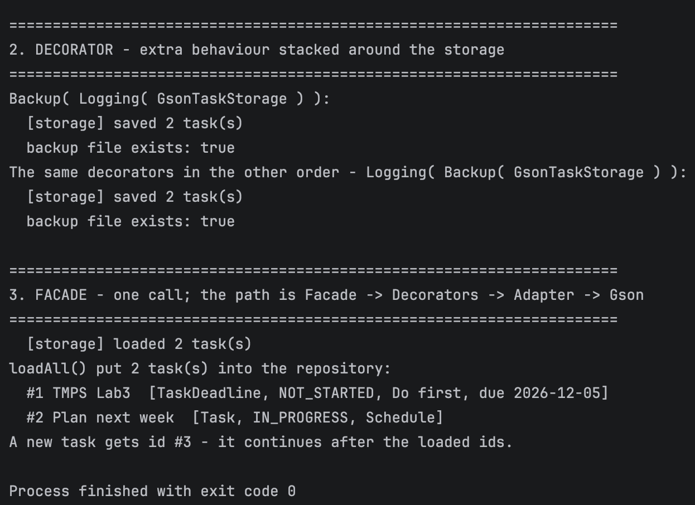
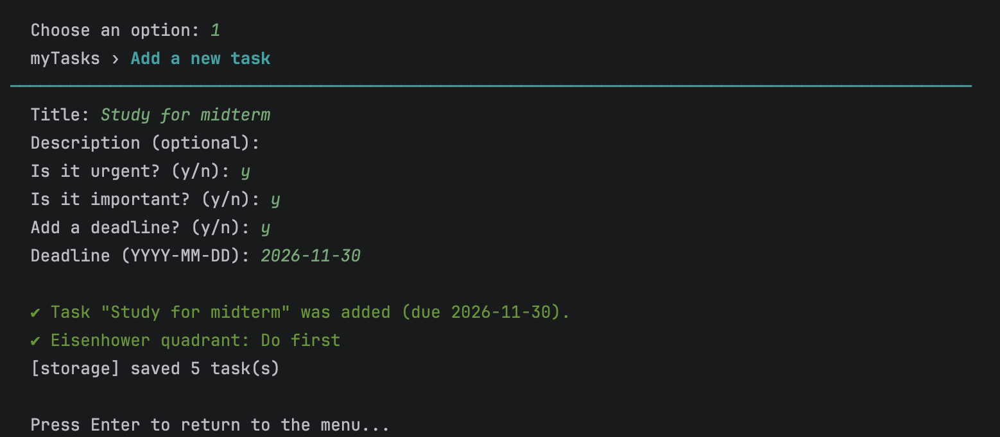
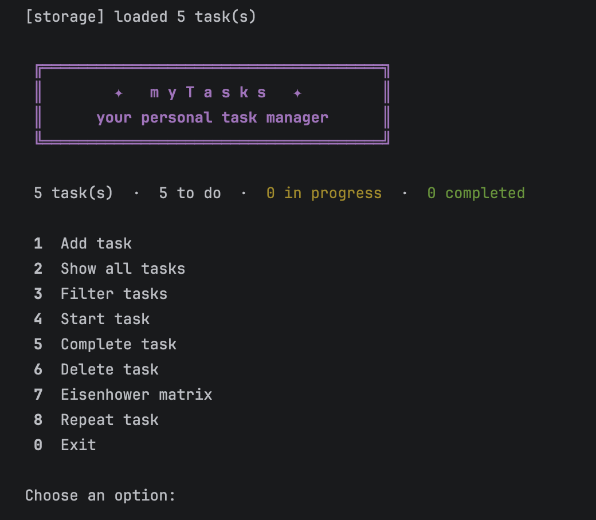

# Lab 3 - Structural Design Patterns: Report

**Project:** myTasks - a personal task manager (console application)\
**Author:** Gabriela Bîtca, FAF-242\
**Language:** Java 21 **Build tool:** Maven

---

## 1. Domain description

**myTasks** is a console task manager built over the previous labs. A user can add tasks (optionally with a deadline), start, complete, repeat and delete them, filter them, and see them in an **Eisenhower matrix** (urgent / important → *Do first, Schedule, Delegate, Eliminate*).

Until this lab, every task was lost when the program closed. In this lab, tasks are **saved to a JSON file after every change and loaded again on the next start**. Saving and loading are built with three structural patterns:

| Pattern | Classes | The problem it solves in myTasks |
|---|---|---|
| **Adapter** | `TaskStorage` (target), `GsonTaskStorage` (adapter), `Gson` (adaptee), `TaskRecord` | Gson is a third-party JSON library I cannot change. It does not know our `Task`/`TaskDeadline` types and cannot handle `LocalDate`. The adapter translates calls and data both ways. |
| **Decorator** | `StorageDecorator` (base), `BackupStorageDecorator`, `LoggingStorageDecorator` | Extra behaviour around saving (a backup of the previous file, a log line) that can be switched on and combined in any order, without changing the storage itself. |
| **Facade** | `PersistenceFacade` | Loading must use the storage, the repository and the id counter together and in the right order. The UI should not know these steps; it calls one method. |

### How the patterns work together

All three patterns are on **one execution path**. When the user completes a task, the console saves through the facade, and the call travels through both decorators to the adapter, which finally calls the Gson library:



The client code depends on **abstractions**: the facade and every decorator only know the `TaskStorage` interface, never the concrete adapter. The concrete classes are chosen in one place, `Main`:

[`Main.java`](src/main/java/com/mytasks/Main.java)
```java
Path file = Path.of("tasks.json");
TaskStorage storage = new BackupStorageDecorator(
        new LoggingStorageDecorator(
                new GsonTaskStorage(file),
                System.out),
        file);
PersistenceFacade persistence = new PersistenceFacade(storage, repository);
```

### Building on the previous labs

- **Builder (Lab 2):** the adapter rebuilds every loaded task with `TaskBuilder`. Two new optional steps were added: `.id(...)` and `.status(...)`, so a loaded task keeps its id and status.
- **Singleton (Lab 2):** after loading, the facade calls `IdGenerator.getInstance().continueAfter(highestId)`, so new tasks never get an id that is already used.
- **Open/Closed (Lab 1):** a new storage format is a new adapter class; a new extra behaviour is a new decorator class. Nothing existing has to be edited.

---

## 2. Patterns

### 2.1 Adapter

> **Intent:** make an existing class with an incompatible interface work with your code.

**The incompatibility.** myTasks wants to call `save(List<Task>)` and `load()`. The Gson library offers something different: `toJson(Object)` and `fromJson(String, Class)`, working with JSON text and simple objects. Gson also cannot store a `LocalDate` (Java blocks it from reading the date's private fields), and it does not know whether to recreate a `Task` or a `TaskDeadline`. Gson is third-party code, so I cannot change it; the adapter translates instead.

#### Class diagram



#### Code

[`adapter/GsonTaskStorage.java`](src/main/java/com/mytasks/adapter/GsonTaskStorage.java)
```java
@Override
public void save(List<Task> tasks) {
    // our objects -> simple records -> JSON text (Gson) -> file
    TaskRecord[] records = new TaskRecord[tasks.size()];
    for (int i = 0; i < tasks.size(); i++) {
        records[i] = toRecord(tasks.get(i));
    }
    String json = gson.toJson(records);
    try {
        Files.writeString(file, json, StandardCharsets.UTF_8);
    } catch (IOException e) {
        throw new UncheckedIOException("Could not save tasks to " + file, e);
    }
}

/** Task -> TaskRecord: turns our types into text, numbers and booleans. */
private TaskRecord toRecord(Task task) {
    TaskRecord record = new TaskRecord();
    record.id = task.getId();
    record.title = task.getTitle();
    record.description = task.getDescription();
    record.status = task.getTaskStatus().name();
    record.urgent = task.isUrgent();
    record.important = task.isImportant();
    if (task instanceof TaskDeadline deadlineTask) {      // the file has to remember which kind of task it was
        record.deadline = deadlineTask.getDeadline().toString();
    }
    return record;
}
```

`GsonTaskStorage` implements our `TaskStorage` interface, but inside it only calls the library (`gson.toJson`, `gson.fromJson`). Every call is translated: our `Task` objects become `TaskRecord`s that Gson understands (the date becomes text, the subclass becomes "has a deadline or not"), and `load()` does the opposite, rebuilding real `Task`/`TaskDeadline` objects with the `TaskBuilder`.

The file Gson writes:

```json
[
  {
    "id": 1,
    "title": "TMPS Lab3",
    "description": "",
    "status": "NOT_STARTED",
    "urgent": true,
    "important": true,
    "deadline": "2026-12-05"
  },
  {
    "id": 2,
    "title": "Plan next week",
    "description": "",
    "status": "IN_PROGRESS",
    "urgent": false,
    "important": true
  }
]
```

#### Unit tests

[`adapter/GsonTaskStorageTest.java`](src/test/java/com/mytasks/adapter/GsonTaskStorageTest.java)

| Test | What it proves |
|---|---|
| `savedTaskIsLoadedBackWithTheSameData` | The adapter translates a task to Gson and back without losing anything: id, title, description, status, urgent, important. |
| `deadlineTaskIsTranslatedBackIntoADeadlineTask` | The two things Gson cannot do alone are translated correctly: the loaded object is again a `TaskDeadline`, with the same `LocalDate`. |
| `missingFileMeansNoTasks` | On the first run, when there is no file yet, `load()` returns an empty list instead of failing. |

---

### 2.2 Decorator

> **Intent:** add responsibilities to an object at runtime by wrapping it, in any combination.

**The problem.** Saving should sometimes do more than just write the file: keep a backup of the previous version, print a log line so the user sees the work was saved. Putting this inside `GsonTaskStorage` would mix several jobs into one class (against SRP), and every new format would need it again. With decorators, each extra behaviour is a separate wrapper that works around **any** `TaskStorage`, and the wrappers can be combined and re-ordered in `Main`.

#### Class diagram



#### Code

[`decorator/StorageDecorator.java`](src/main/java/com/mytasks/decorator/StorageDecorator.java)
```java
public abstract class StorageDecorator implements TaskStorage {

    protected final TaskStorage wrapped;

    protected StorageDecorator(TaskStorage wrapped) {
        this.wrapped = wrapped;
    }

    @Override
    public void save(List<Task> tasks) {
        wrapped.save(tasks);
    }
    // load() delegates the same way
}
```

[`decorator/BackupStorageDecorator.java`](src/main/java/com/mytasks/decorator/BackupStorageDecorator.java)
```java
@Override
public void save(List<Task> tasks) {
    if (Files.exists(file)) {
        try {
            Files.copy(file, backup, StandardCopyOption.REPLACE_EXISTING);   // the added behaviour
        } catch (IOException e) {
            throw new UncheckedIOException("Could not create backup " + backup, e);
        }
    }
    wrapped.save(tasks);                                                    // then the normal save
}
```

[`decorator/LoggingStorageDecorator.java`](src/main/java/com/mytasks/decorator/LoggingStorageDecorator.java)
```java
@Override
public void save(List<Task> tasks) {
    wrapped.save(tasks);                                         // the normal save
    log.println("  [storage] saved " + tasks.size() + " task(s)");   // the added behaviour
}
```

A decorator **is** a `TaskStorage` (it implements the interface) and **has** a `TaskStorage` (the `wrapped` field). It does its own extra work and then calls the wrapped object, so the normal behaviour is never lost. Because the wrapped object is only known as `TaskStorage`, it can be the real adapter or another decorator, so decorators stack in any order: `Backup(Logging(Gson))` and `Logging(Backup(Gson))` both work.

#### Unit tests

[`decorator/StorageDecoratorTest.java`](src/test/java/com/mytasks/decorator/StorageDecoratorTest.java)

| Test | What it proves |
|---|---|
| `decoratorsGiveTheSameResultInAnyOrder` | `Backup(Logging(Gson))` and `Logging(Backup(Gson))` save the same data, both create the backup, and both write the same log. |
| `backupKeepsThePreviousVersion` | After two saves, `tasks.json.bak` contains the first version and `tasks.json` the second, so the decorator added its behaviour and kept the normal one. |
| `loggingDecoratorAddsALogAndPassesCallsThroughUnchanged` | The logging decorator writes "saved 2 task(s)" / "loaded 2 task(s)" and still returns exactly the tasks of the wrapped storage. |

---

### 2.3 Facade

> **Intent:** provide one simple interface to a complex subsystem.

**The problem.** Loading tasks is not one step. The tasks must be read from storage, added to the `TaskRepository`, and the `IdGenerator` Singleton must be moved past the highest loaded id; otherwise the next new task would get id 1 again and two tasks would share an id. If `Main` and `ConsoleUI` did this themselves, they would need to know all these classes and the right order. The facade hides this behind `loadAll()` and `saveAll()`. It only **delegates**; it has no business logic of its own, so it does not become a god class.

#### Class diagram



#### Code

[`facade/PersistenceFacade.java`](src/main/java/com/mytasks/facade/PersistenceFacade.java)
```java
/** Loads the saved tasks into the repository. Returns how many tasks were loaded. */
public int loadAll() {
    List<Task> tasks = storage.load();                        // 1. read them from storage

    int highestId = 0;
    for (Task task : tasks) {
        repository.add(task);                                 // 2. put them in the repository
        highestId = Math.max(highestId, task.getId());
    }

    IdGenerator.getInstance().continueAfter(highestId);       // 3. new tasks get ids after the loaded ones
    return tasks.size();
}

/** Saves every task from the repository. */
public void saveAll() {
    storage.save(repository.findAll());
}
```

The client sees two methods. Behind them, the facade calls three parts of the subsystem in the correct order. The storage it uses is only known as `TaskStorage`, so the same facade works with any adapter wrapped in any decorators.

How the client uses it:

[`ui/ConsoleUI.java`](src/main/java/com/mytasks/ui/ConsoleUI.java)
```java
if (changesTasks(choice)) {
    persistence.saveAll();     // Lab 3: every change is saved right away
}
```

#### Unit tests

[`facade/PersistenceFacadeTest.java`](src/test/java/com/mytasks/facade/PersistenceFacadeTest.java). These use a **stub** storage that keeps tasks in memory and records which methods were called.

| Test | What it proves |
|---|---|
| `loadAllPutsTheSavedTasksIntoTheRepository` | `loadAll()` reads from storage once (only `load`, no `save`) and puts every loaded task into the repository. |
| `newIdsContinueAfterTheHighestLoadedId` | After loading a task with id 5000, the next new task gets id 5001, so the facade also updated the `IdGenerator` Singleton. |
| `saveAllSendsEveryTaskFromTheRepositoryToStorage` | `saveAll()` calls `save` once with all tasks from the repository. |

---

## 3. Evidence

### Unit tests

All 9 tests (3 per pattern) pass with `mvn -pl lab3 test`:



### Demo

`Demo.java` runs the three patterns one after another (in a temporary folder):


### The app

After a change, the log line from the decorator shows that the tasks were saved:



After closing and starting the app again, the tasks are still there, with their statuses:



---

## 4. Patterns not implemented

| Pattern | Intent | How it could look in myTasks |
|---|---|---|
| **Bridge** | Separate an abstraction from its implementation so both can vary independently | Reminders (`DeadlineReminder`, `DailySummaryReminder`) on one side, channels (`ConsoleChannel`, `EmailChannel`) on the other; any reminder can be sent through any channel. |
| **Composite** | Treat single objects and groups of objects the same way | A `Project` that contains tasks and sub-projects; `getProgress()` works the same on one task and on a whole project. |
| **Flyweight** | Share common state between many small objects to save memory | All tasks of one quadrant share one `QuadrantStyle` object (label, color, meaning) instead of each task keeping its own copy. |
| **Proxy** | Control access to an object through a stand-in with the same interface | A `ReadOnlyStorageProxy` implementing `TaskStorage` that allows `load()` but blocks `save()` in a "view only" mode. Unlike a decorator, it decides **whether** the call reaches the real object. |

---

## 5. Conclusions

**What was harder than expected.**

- **Gson could not save my objects directly.** Since Java 17, Gson is not allowed to read the private fields of `LocalDate`, and it has no way of knowing that some tasks are `TaskDeadline`s. This is exactly why the adapter is needed: it translates my objects into a simple `TaskRecord` and back, instead of passing them to Gson as they are.
- **The id counter after loading.** Loading the tasks back was not enough: the `IdGenerator` starts at 1 on every program start, so the next new task would get an id that a loaded task already has. The facade now moves the Singleton past the highest loaded id, and a test checks it.
- **Keeping the facade small.** It was tempting to put saving logic (when to save, what to print) into the facade. I kept it to pure delegation; the printing is the logging decorator's job and the decision of when to save is the UI's.

**What I would design differently.**

- `BackupStorageDecorator` needs the file path, so it only makes sense around a storage that writes a file. A better design would give `TaskStorage` a way to describe where it saves, so the backup decorator would not need its own copy of the path.
- The adapter uses one `instanceof TaskDeadline` to know whether to store a deadline. Adding a `hasDeadline()`/`getDeadline()` method to `Task` itself would remove it.
- Saving the whole file after every change is simple and safe for a personal task list, but it would be slow for thousands of tasks; then saving only changed tasks (or on exit) would be better.
