# Lab 4 - Behavioral Design Patterns: Report

**Project:** myTasks - a personal task manager (console application)\
**Author:** Gabriela Bîtca, FAF-242\
**Language:** Java 21 **Build tool:** Maven

---

## 1. Domain description

**myTasks** is a console task manager built over the previous labs. A user adds tasks (optionally with a deadline), sees them in an **Eisenhower matrix** (urgent / important), filters and repeats them, and every change is saved to a JSON file (Lab 3).

This lab solves three problems the app still had:

| Pattern | Classes | The problem it solves in myTasks |
|---|---|---|
| **State** | `Task` (context), `TaskState`, `NotStartedState`, `InProgressState`, `CompletedState` | Until now any status could be set at any time, e.g. "complete" a task that was never started. Now each state decides which steps are allowed: *To do → In progress → Completed → (reopen) → In progress*. |
| **Command** | `Command`, `CommandHistory` (invoker), `AddTaskCommand`, `StartTaskCommand`, `CompleteTaskCommand`, `ReopenTaskCommand`, `DeleteTaskCommand`, `RepeatTaskCommand`, `TaskService` (receiver) | A deleted or wrongly completed task could not be brought back. Every action is now an object kept in a history, so it can be **undone and redone**. |
| **Observer** | `TaskEventPublisher` (subject), `TaskObserver`, `ActivityLogObserver`, `AutoSaveObserver`, `NotificationObserver` | In Lab 3 the UI had to remember to save after each menu option. Now saving, the activity log and notifications simply **react to task events**, and they can be switched on or off while the app runs. |

### How the patterns work together

All three patterns are on **one execution path**, which continues into the structural patterns from Lab 3. When the user chooses *Complete task*:

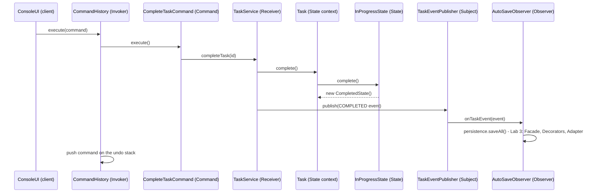

If the state refuses the step (for example *complete* on a task that was never started), the `IllegalStateException` stops the path at once: no event is published, nothing is saved, and the command is **not** added to the history.

Every part only knows abstractions: `CommandHistory` knows `Command`, `Task` knows `TaskState`, `TaskEventPublisher` knows `TaskObserver`. The concrete classes are chosen in `Main` and in the UI.

### Behaviour that changes at runtime (advanced requirement A)

- **Observer:** in *Settings* (option 13) the user can switch **Auto-save** and **Notifications** on and off. Each switch calls `subscribe` / `unsubscribe` on the subject while the program runs.
- **State:** every start / complete / reopen moves the task to another state object, and its behaviour changes with it.
- **Command:** *Undo* and *Redo* (options 10 and 11) walk back and forward through the history.

### Building on the previous labs

- **Builder (Lab 2):** `AddTaskCommand` receives a `TaskBuilder`. The builder also restores saved statuses through `Task.restoreStatus`.
- **Prototype (Lab 2):** `RepeatTaskCommand` uses `Task.copy()`, and its undo removes the copy.
- **Facade, Decorator, Adapter (Lab 3):** `AutoSaveObserver` saves through the `PersistenceFacade`, so every saved change still goes through the backup and logging decorators and the Gson adapter.

---

## 2. Patterns

### 2.1 State

> **Intent:** let an object change its behaviour when its internal state changes, as if it changed its class.

**The problem.** A task has a lifecycle, and not every step makes sense at every moment. Writing it with `if`/`switch` on a status enum inside `Task` would put all the rules for all the statuses in one method, and every new status would mean editing it. With the State pattern each status is a class that knows only **its own** allowed steps, and `Task` just asks its current state.

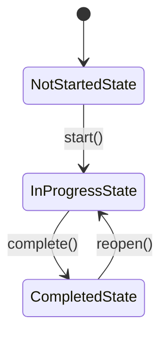

#### Class diagram

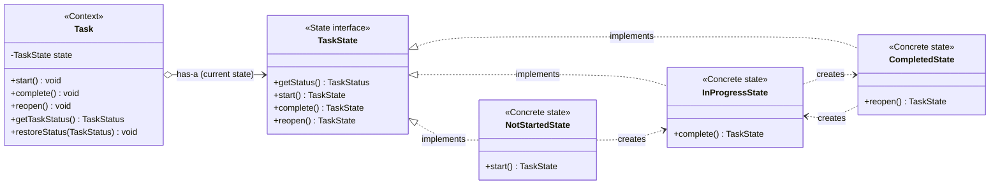

#### Code

[`model/Task.java`](src/main/java/com/mytasks/model/Task.java) (the context delegating to its current state):
```java
// State: the task does not decide itself; it asks its current state, which returns the next state.
// A forbidden transition throws an IllegalStateException and the state stays the same.
public void start(){
    state = state.start();
}

public void complete(){
    state = state.complete();
}

public void reopen(){
    state = state.reopen();
}
```

[`state/TaskState.java`](src/main/java/com/mytasks/state/TaskState.java) and [`state/InProgressState.java`](src/main/java/com/mytasks/state/InProgressState.java):
```java
default TaskState complete() {
    throw forbidden("complete");
}

public class InProgressState implements TaskState {

    @Override
    public TaskStatus getStatus() {
        return TaskStatus.IN_PROGRESS;
    }

    @Override
    public TaskState complete() {
        return new CompletedState();
    }
}
```

`Task` has no `if` or `switch` on its status: it forwards each step to its current `TaskState` object and keeps whatever state comes back. In the interface every step is forbidden by default, and each concrete state overrides only the steps it allows and returns the next state, so the rules for one status live in one small class.

#### Unit tests

[`state/TaskStateTest.java`](src/test/java/com/mytasks/state/TaskStateTest.java)

| Test | What it proves |
|---|---|
| `validTransitionsFollowTheWorkflow` | A new task is *not started*; `start → complete → reopen` move it to *in progress → completed → in progress*. |
| `forbiddenTransitionsAreRejectedAndChangeNothing` | *complete* / *reopen* on a not-started task and *start* / *complete* on a completed task throw `IllegalStateException`, and the status stays the same. |
| `eachStateReportsItsOwnStatus` | Every concrete state reports the matching `TaskStatus` (used by filters, the table and the saved file). |

---

### 2.2 Command

> **Intent:** turn a request into an object, so it can be stored, queued, logged or undone.

**The problem.** Mistakes happen: deleting the wrong task or completing it too early. To undo an action, the program must remember *what* was done and *how* to reverse it. With commands, every action is an object with `execute()` and `undo()`, and the `CommandHistory` keeps them in an undo stack and a redo stack. The real work stays in the **receiver** (`TaskService` and the task's state); a command only calls it and remembers what it needs for undo.

#### Class diagram

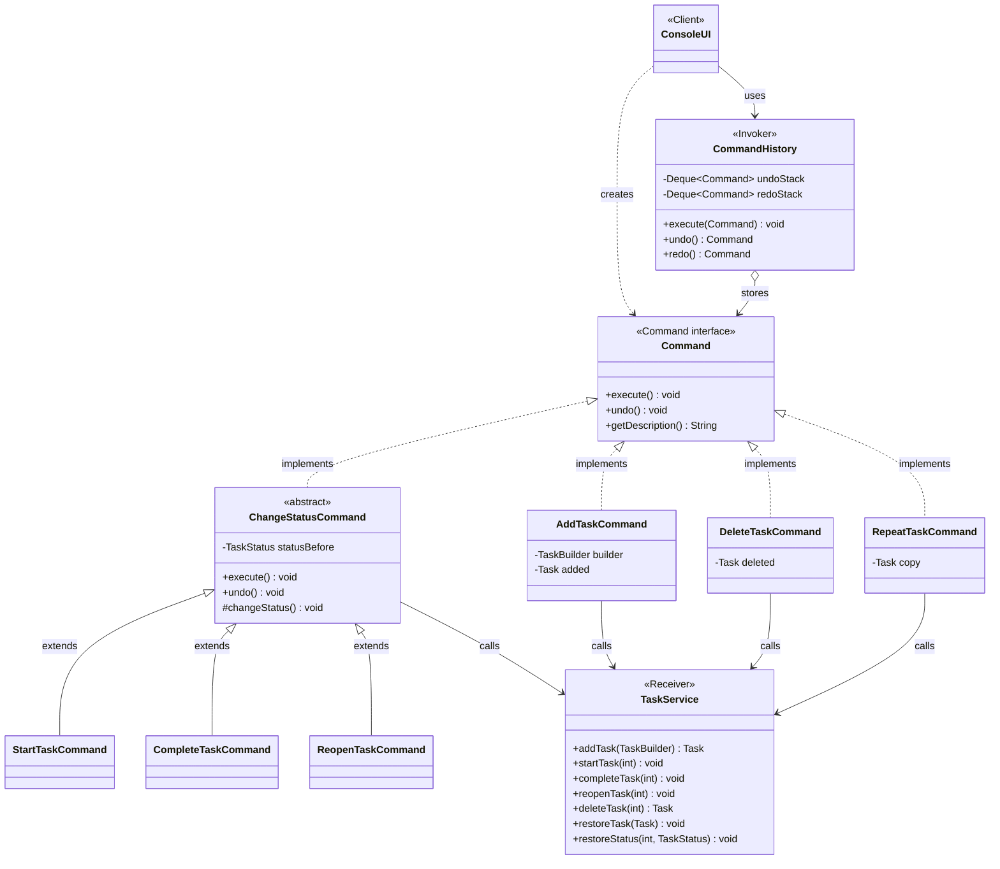

#### Code

[`command/ChangeStatusCommand.java`](src/main/java/com/mytasks/command/ChangeStatusCommand.java) (the execute / undo pair):
```java
@Override
public final void execute() {
    statusBefore = service.getTask(taskId).getTaskStatus();   // remember, for undo
    changeStatus();                                          // the transition itself (may be refused)
}

@Override
public final void undo() {
    service.restoreStatus(taskId, statusBefore);
}
```

[`command/CommandHistory.java`](src/main/java/com/mytasks/command/CommandHistory.java) (the invoker):
```java
/** Runs the command. Only a command that succeeded is remembered (a failing one throws first). */
public void execute(Command command) {
    command.execute();
    undoStack.push(command);
    redoStack.clear();           // a new action makes the old "redo" steps meaningless
}

/** Undoes the last command and returns it, or returns null if there is nothing to undo. */
public Command undo() {
    if (undoStack.isEmpty()) {
        return null;
    }
    Command command = undoStack.pop();
    command.undo();
    redoStack.push(command);
    return command;
}
```

Before changing anything, the command saves what it needs to reverse it (the status before, the deleted task, the added task). The history only knows the `Command` interface, so it can undo any action without knowing what it does. A new action is a new `Command` class; the history and the UI loop stay unchanged.

#### Unit tests

[`command/CommandHistoryTest.java`](src/test/java/com/mytasks/command/CommandHistoryTest.java)

| Test | What it proves |
|---|---|
| `executingThenUndoingRestoresTheOriginalState` | Start then Complete, then two undos give back *in progress* and then *not started*; redo applies *start* again. |
| `undoingADeleteBringsBackTheSameTask` | After Delete and undo, the very same task object is back (same id, same status). |
| `aRefusedCommandIsNotAddedToTheHistory` | A command refused by the task's state throws, leaves the task unchanged and is not added to the undo stack. |

---

### 2.3 Observer

> **Intent:** when one object changes, notify all the objects that depend on it, automatically.

**The problem.** Several parts of the app want to know when a task changes: the file must be saved, the activity log must write a line, and a notification may be shown. If `TaskService` called each of them directly, it would depend on all of them, and adding one more reaction would mean editing the service. With Observer, the service only publishes an event to the subject; whoever is subscribed reacts. Observers can subscribe and unsubscribe while the app runs.

#### Class diagram

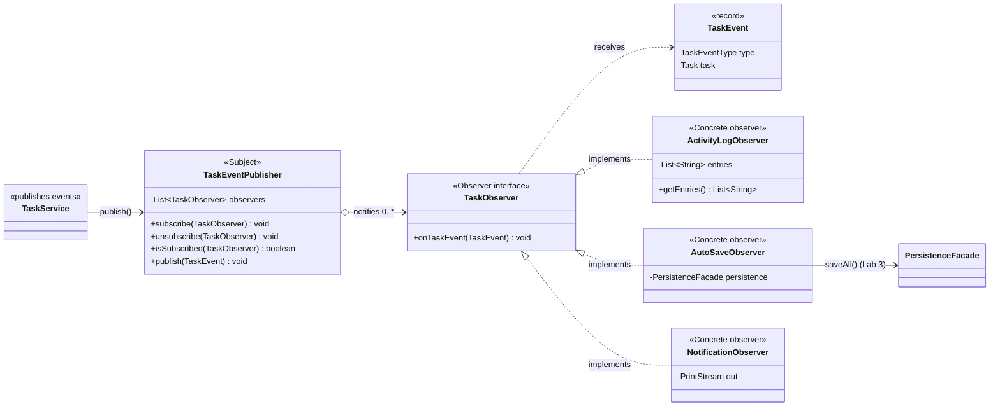

#### Code

[`observer/TaskEventPublisher.java`](src/main/java/com/mytasks/observer/TaskEventPublisher.java) (the subject's notify loop):
```java
public void subscribe(TaskObserver observer) {
    if (!observers.contains(observer)) {
        observers.add(observer);
    }
}

public void unsubscribe(TaskObserver observer) {
    observers.remove(observer);
}

/** The notify loop: every subscribed observer gets the event. */
public void publish(TaskEvent event) {
    // a copy of the list, so an observer may unsubscribe while it is being notified
    for (TaskObserver observer : List.copyOf(observers)) {
        observer.onTaskEvent(event);
    }
}
```

[`service/TaskService.java`](src/main/java/com/mytasks/service/TaskService.java) and [`observer/AutoSaveObserver.java`](src/main/java/com/mytasks/observer/AutoSaveObserver.java):
```java
public void completeTask(int id) {
    Task task = getTask(id);
    task.complete();
    events.publish(new TaskEvent(TaskEventType.COMPLETED, task));
}

@Override
public void onTaskEvent(TaskEvent event) {
    persistence.saveAll();
}
```

The subject keeps a list typed by the `TaskObserver` interface, so it never depends on a concrete observer, and `publish` simply loops over whoever is subscribed at that moment. The service publishes **after** the change succeeded, and observers only read the task (they never change it), so a notification can never trigger another notification in a loop.

#### Unit tests

[`observer/TaskEventPublisherTest.java`](src/test/java/com/mytasks/observer/TaskEventPublisherTest.java)

| Test | What it proves |
|---|---|
| `allSubscribedObserversAreNotified` | Two subscribed observers both receive the same event. |
| `anUnsubscribedObserverIsNotNotified` | After `unsubscribe`, an observer receives nothing; the other one still does. |
| `activityLogObserverWritesDownEveryEvent` | The activity log observer records one readable line per event. |

### 2.4 The three patterns together

[`PatternInteractionTest.java`](src/test/java/com/mytasks/PatternInteractionTest.java)

| Test | What it proves |
|---|---|
| `aCommandChangesTheStateAndTheObserversReactToIt` | Start and Complete commands move the task to *completed* (State); the auto-save observer saved after each change and the activity log recorded it (Observer); a step the state forbids is refused and causes no extra save. |

---

## 3. Evidence

### Unit tests

All 19 tests pass with `mvn -pl lab4 test` (10 new tests for this lab and the 9 from Lab 3):

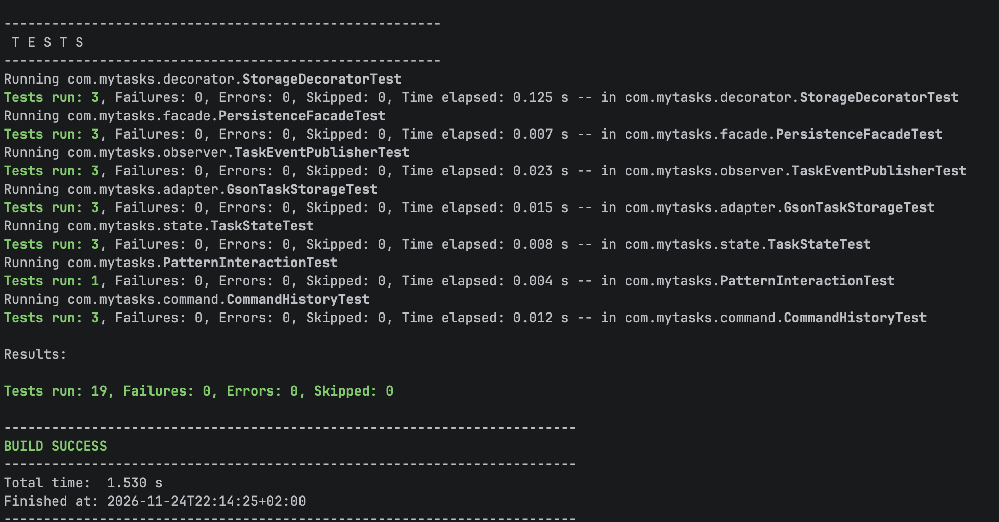

### Demo

`Demo.java` shows each pattern and then the full path:

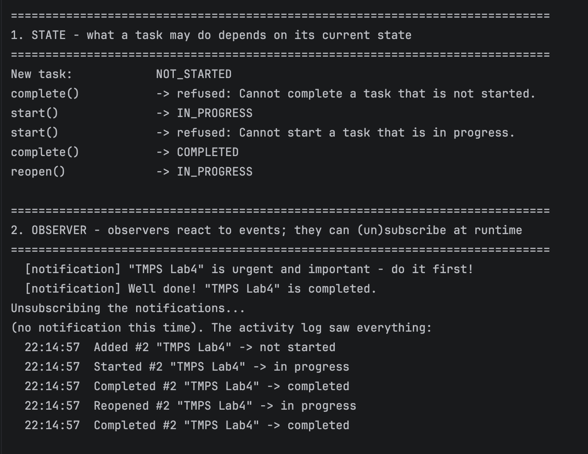
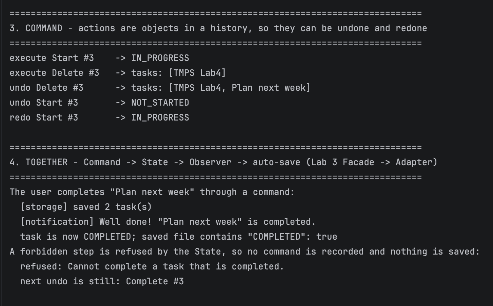

### The app

A forbidden step refused by the State, then Undo / Redo in the menu:

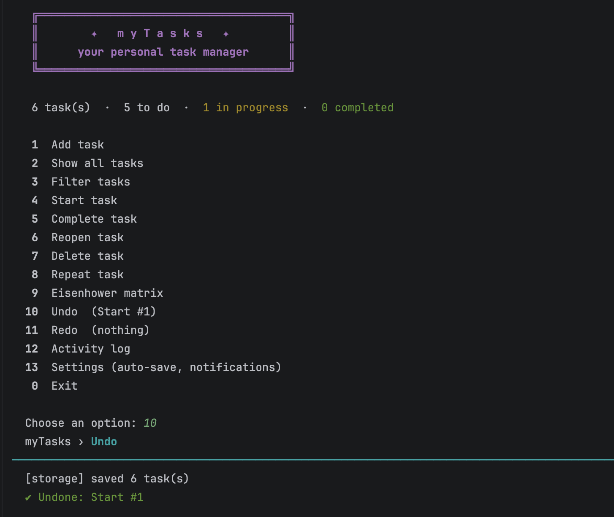

Settings: switching observers on and off while the app runs, and the activity log:

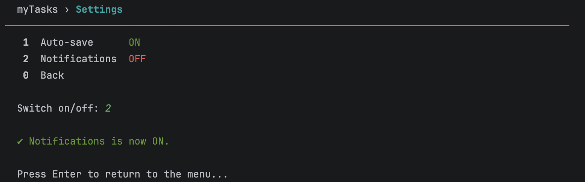

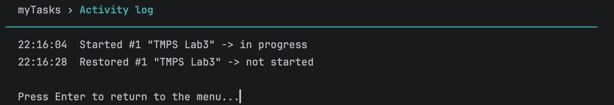

---

## 4. Patterns not implemented

| Pattern | Intent | How it could look in myTasks |
|---|---|---|
| **Chain of Responsibility** | Pass a request along a chain of handlers until one handles it | Checking a new task: `TitleCheck → DeadlineNotInPastCheck → DuplicateTitleCheck`; each handler either rejects the task or passes it on, and the end of the chain accepts it. |
| **Iterator** | Traverse a collection without exposing its internal structure | A `QuadrantIterator` that walks tasks in Eisenhower order (Do first, Schedule, Delegate, Eliminate) without exposing the repository's list. |
| **Mediator** | Let objects communicate through a central mediator instead of referencing each other | In a GUI, the task list, the filter box and the details panel would talk only to a `ScreenMediator`, not to each other. |
| **Memento** | Capture and restore an object's state without breaking encapsulation | Undo by snapshots: before each command, `Task.save()` returns an opaque `TaskMemento`; undo calls `task.restore(memento)`. |
| **Strategy** | Define interchangeable algorithms and choose one at runtime | Sorting the task list: `SortByDeadline`, `SortByQuadrant`, `SortByTitle`, all implementing `SortStrategy`, chosen from the menu. |
| **Template Method** | Define an algorithm's skeleton in a base class and let subclasses override steps | An `Exporter` with a fixed `export()` = header → each task → footer, with `CsvExporter` and `MarkdownExporter` filling in the steps. |
| **Visitor** | Add operations to an object structure without changing its classes | A `TaskVisitor` with `visit(Task)` and `visit(TaskDeadline)`, e.g. a `StatisticsVisitor`, using `accept(visitor)` for double dispatch instead of `instanceof`. |
| **Interpreter** *(good to know)* | Define a grammar and evaluate sentences of a simple language | A search language like `urgent AND NOT completed`, parsed into expression objects that each `interpret(task)`. |

---

## 5. Conclusions

**What was harder than expected.**

- **Undo and the State rules.** Undo must be able to go *back*, for example from *completed* to *in progress*, but that is not an allowed transition. I solved it by separating the two: transitions go through the state (`start`, `complete`, `reopen`), while undo uses `restoreStatus`, which puts back a remembered status and is not a workflow step. The same method is used when loading the saved file.
- **Failed commands.** A command refused by the state must not end up in the history; otherwise "undo" would try to reverse something that never happened. `CommandHistory.execute` runs the command first and stores it only if no exception was thrown.
- **Redo of "add" and "repeat".** Running them again would create a new task with a new id. These commands remember the task they created, and redo puts back that same task instead.

**What I would design differently.**

- A new state, for example *Blocked*, needs a new class **and** changes in the states that lead to it, plus a new `TaskStatus` value. That is normal for the State pattern, but a transition table could reduce the edits.
- Undo could be built with the **Memento** pattern (a full snapshot of the task) instead of each command remembering its own data. That would be simpler when a task gets many more fields.
- The service publishes events itself. If more parts of the program changed tasks, it would be safer if `Task` raised the events, so no change could be forgotten.
